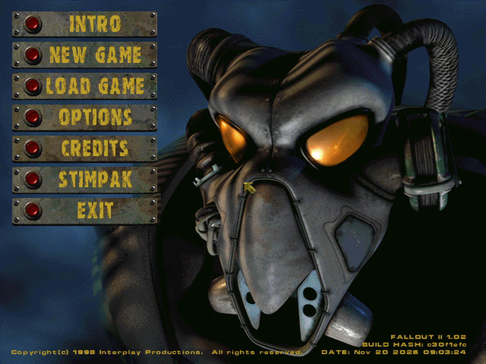
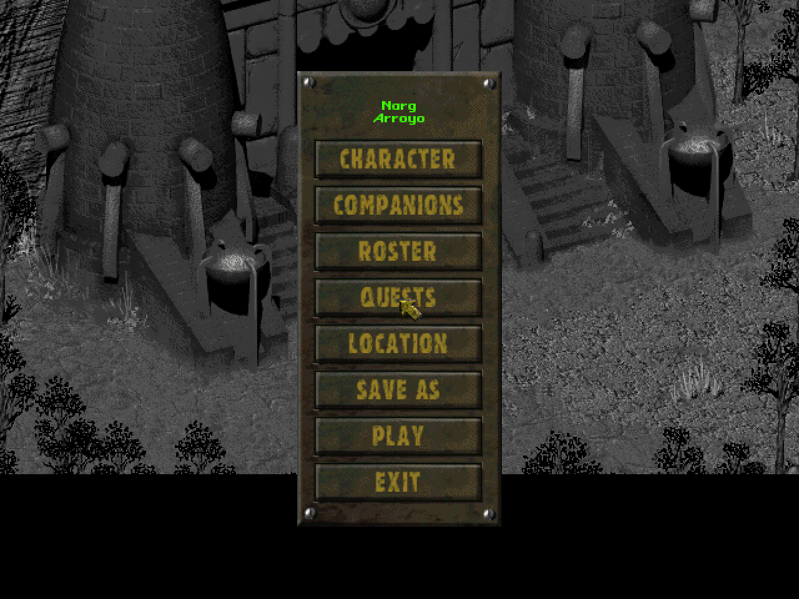
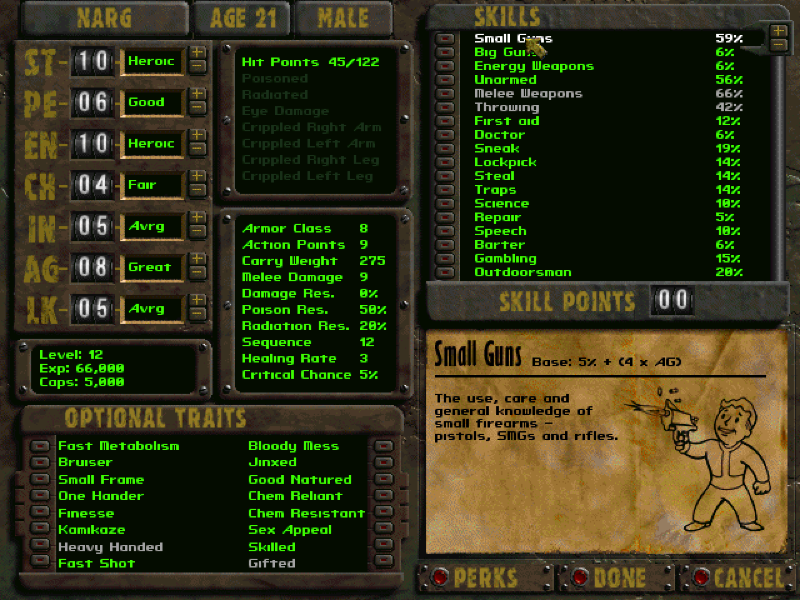
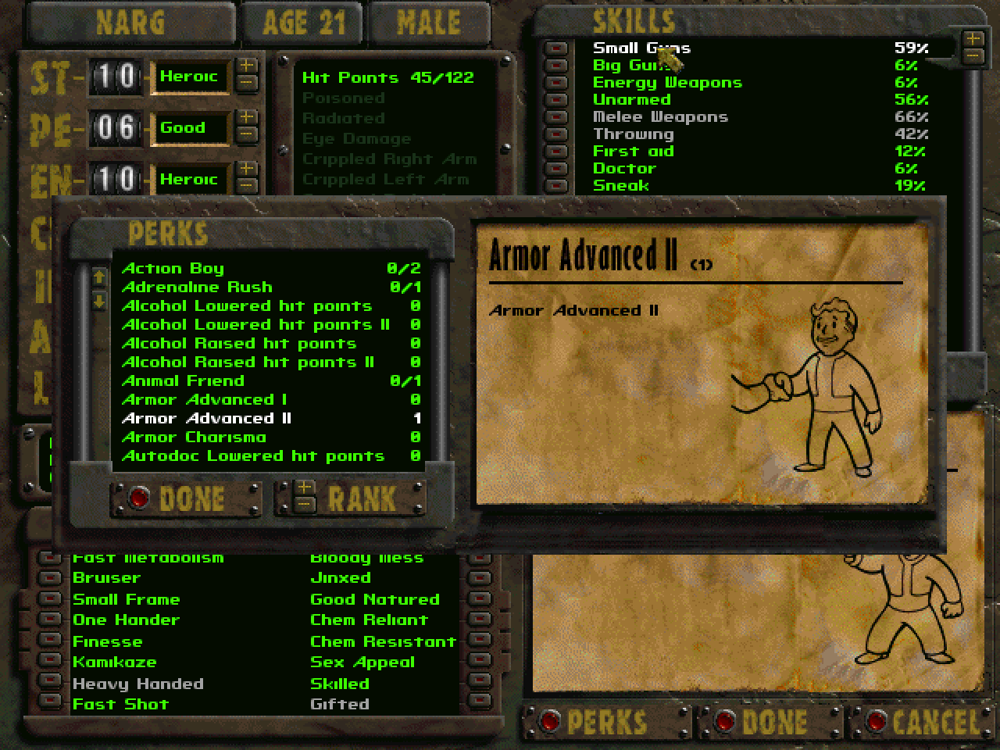
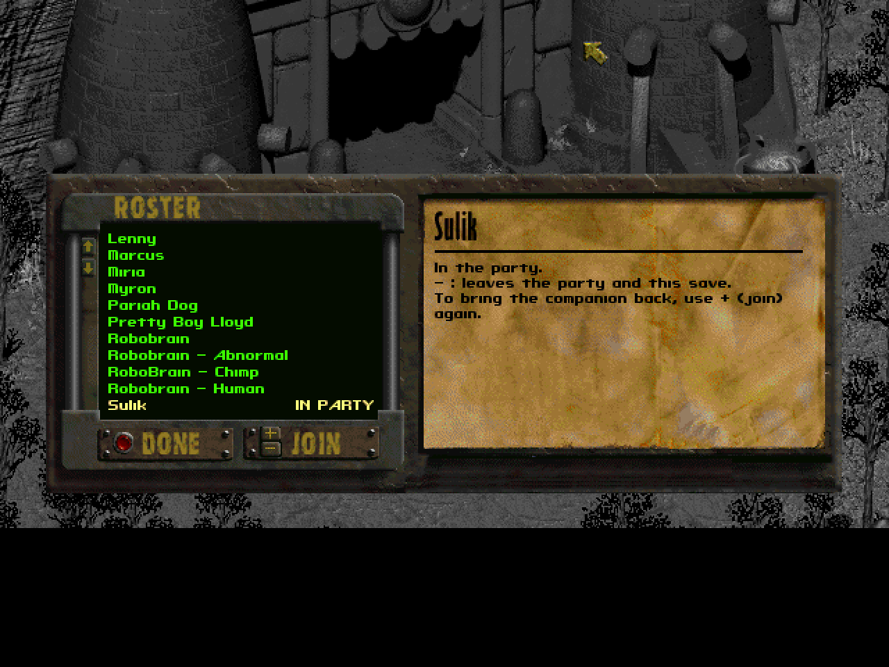
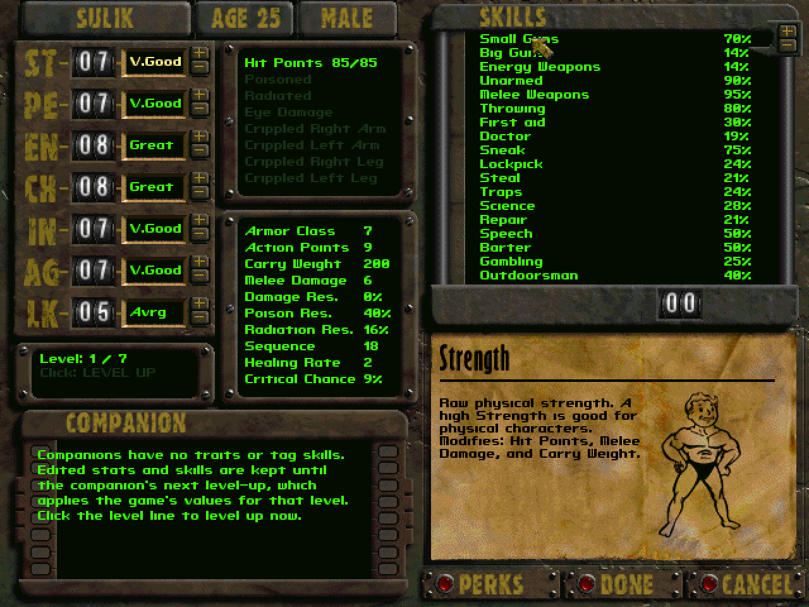
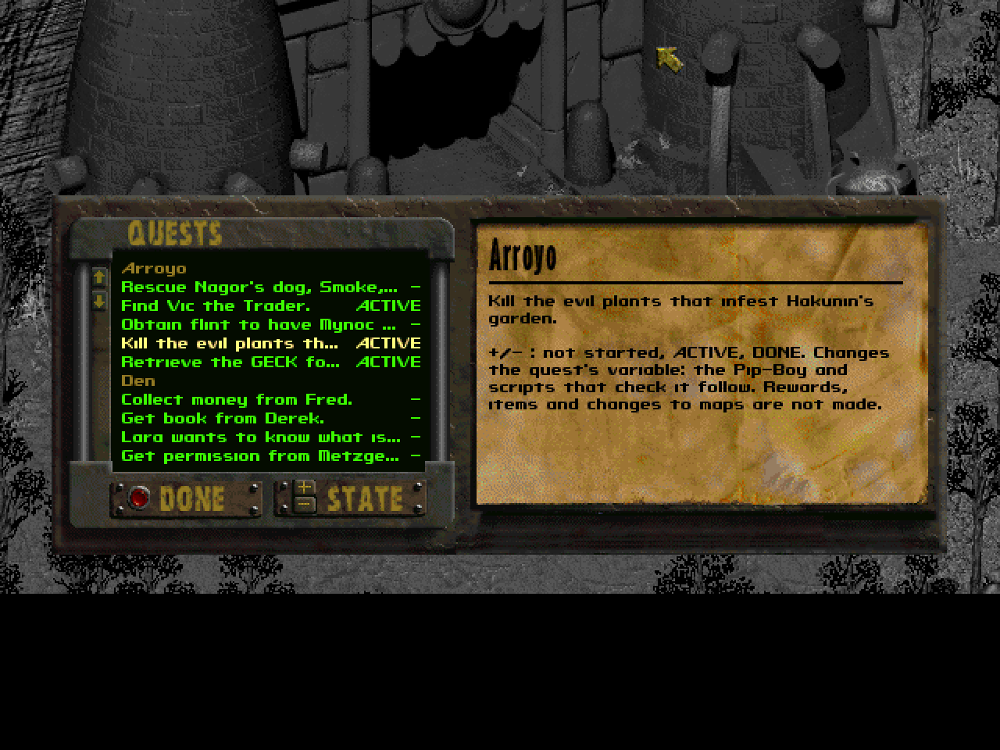
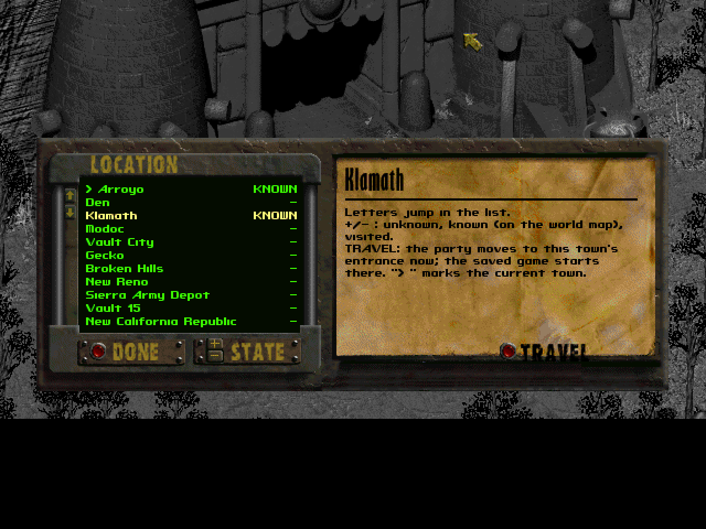
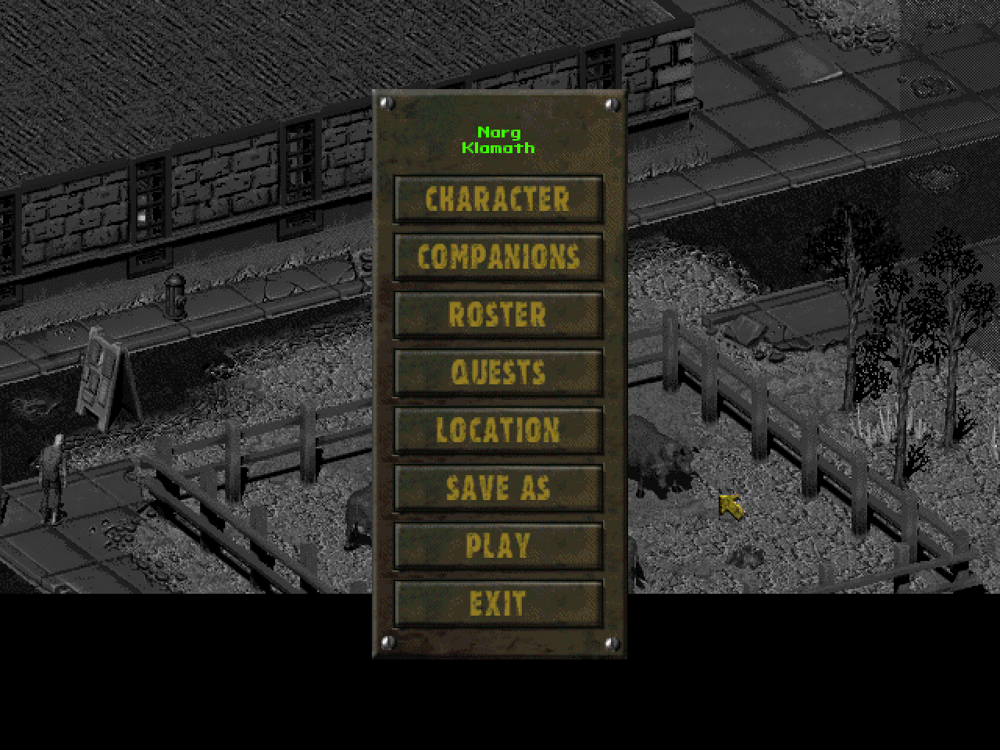
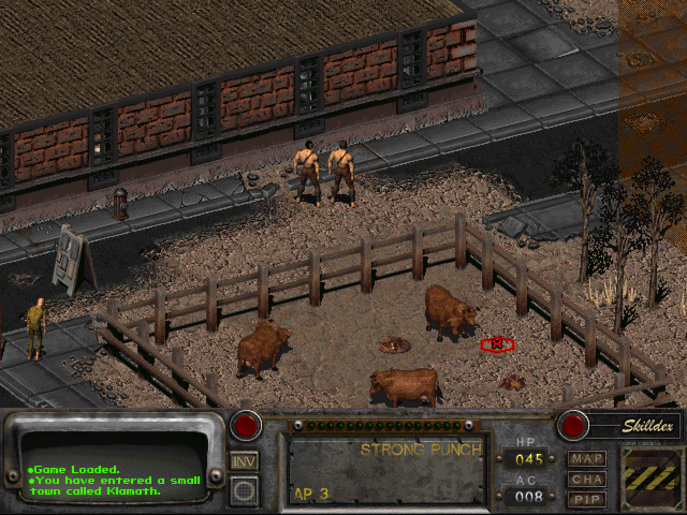

# Stimpak

Stimpak is a savegame editor that runs inside [Fallout 2 Community Edition](https://github.com/fallout2-ce/fallout2-ce).
It adds a **STIMPAK** button to the main menu. Pick a saved game, change your
character, your companions, the party, quests or where you are, then save the
result as a new saved game in a slot you choose, or play on with it straight
away.

The editor uses the game's own screens and rules, so what you edit is what the game
will load: stats are capped where the game caps them, derived values (hit points,
carry weight, action points and so on) are recalculated by the game, and the save
is written by the game's own save code.

## What you can edit

| Screen | What it changes |
| --- | --- |
| **Character** | The seven SPECIAL stats (1 to 10), skills (no skill-point cost), tag skills, traits, perks (add or remove any perk and rank), level, experience, hit points, unspent skill points and money (bottle caps). |
| **Companions** | Each companion's stats, skills, hit points and perks. A companion can be levelled up on the spot. |
| **Roster** | Who is in the party: a companion can join or leave. *Experimental*, see [Limits](#limits). |
| **Quests** | Any quest can be set to not started, active or done. |
| **Location** | Towns can be marked unknown, known or visited on the world map, and the party can travel to any town at once. |

Then **PLAY** goes straight into the game with your changes, without saving
first; **SAVE AS** opens the game's save screen on the first empty slot; **EXIT**
returns to the main menu (if you leave with unsaved changes, Stimpak asks you to
confirm).

## Screenshots

| | |
| --- | --- |
|  |  |
| The **STIMPAK** button in the main menu | The hub over the loaded game |
|  |  |
| Character: Strength, Small Guns, level 12, 5000 caps | Perks: any perk, any rank |
|  |  |
| Roster: Sulik joins the party | Companions: Sulik's stats and skills |
|  |  |
| Quests: set any quest's state | Location: towns on the world map, travel |
|  |  |
| The party is now in Klamath | **PLAY**: straight into the edited game |

`tools/screenshots.py` makes these images from a real build and your own game data.

## Installing

You need your own copy of Fallout 2 (GOG, Steam or the original CD release).
Stimpak is a complete build of Fallout 2 Community Edition with the editor added:
it replaces the CE executable, or plays a vanilla installation.

1. Download the package for your system from the releases page:
   `stimpak-<version>-macos.zip`, `-windows-x64.zip` or `-linux-x64.tar.gz`.
2. Follow [docs/INSTALL.md](docs/INSTALL.md) (also inside the package). In short:
   put the executable next to your game's `master.dat` and `critter.dat`, the same
   way Fallout 2 Community Edition is installed.

Your saved games stay where they are. They are compatible both ways with Fallout 2
Community Edition: Stimpak only adds the editor and writes ordinary saves.

## Using it

1. Start the game and choose **STIMPAK** in the main menu (or press **S**).
2. Pick a saved game in the load screen. Games saved during combat cannot be edited.
3. The Stimpak hub opens over the loaded map. Choose a screen (each has a hotkey:
   **C**haracter, c**O**mpanions, **R**oster, **Q**uests, **L**ocation).
4. When you are done, choose **PLAY** to play on at once (save in the game as
   usual whenever you like), or **SAVE AS** to keep the result as a saved game,
   pick a slot and type a description, and load it later from **LOAD GAME**.

[docs/USAGE.md](docs/USAGE.md) describes every screen and key.

## Limits

* **Roster changes are experimental.** A companion who joins through Stimpak has
  not been through the game's own recruitment. Their dialogue may not know about
  it, and the original character elsewhere in the world is removed when that map
  is next loaded. Removing a companion takes them out of the game for that save.
* **Quests**: changing a quest's state changes the game variable behind it. The
  Pip-Boy and scripts that check it follow, but rewards, items and changes to maps
  that the quest would have made are not made.
* **Companion edits** last until the companion's next level-up, when the game
  applies its own values for that level. Edits made at their last level stay.
* **Travel** moves the party to the town's first entrance; the saved game starts
  there.
* Games saved during combat cannot be edited (saving them again would keep a
  half-restored combat).

Back up the saves you care about. Stimpak saves into a slot you choose, but a
saved game edited into a state the story does not expect can make quests
impossible to finish.

## Building from source

```sh
git clone --recurse-submodules <this repository> stimpak
cd stimpak
tools/build.sh Release          # or Debug
tools/package.sh                # the release archive for this system, in dist/
```

You need CMake 3.19 or newer, a C++17 compiler, Python 3.8 or newer and git. See
[docs/BUILDING.md](docs/BUILDING.md) for platforms, tests and how the build works.

## How it is built

Stimpak is a layer on top of an unmodified Fallout 2 Community Edition source tree:

* `engine/` is Fallout 2 Community Edition as a git submodule, pinned to the
  commit in `engine-version.txt`.
* `src/` holds Stimpak's own code: the editor and its screens (`stimpak.cc`), the
  menu art it builds at run time from the player's own game images
  (`stimpak_art.cc`), and a scripted test mode (`dev_automation.cc`).
* `patches/src/<file>.patch` holds one small patch per engine file Stimpak hooks
  into: the main-menu button, the editor mode of the game's character screen,
  accessors for quests, towns and companions, and the test-mode hooks.
* At build time `tools/stimpak_tree.py` mirrors the engine's `src/` into the build
  folder, applies the patches there and adds Stimpak's sources; CMake
  (`cmake/Stimpak.cmake`) compiles the game from that tree. Only changed files are
  rewritten, so rebuilds stay incremental, and compiler messages point at the
  original files.
* The English texts are compiled in; `stimpak.msg` files in the game data add
  translations.

## Adding Stimpak to another build of the game

Another project built on Fallout 2 Community Edition includes Stimpak as a git
submodule and attaches it with two lines in its CMakeLists.txt. Graphics mods hook
into its screens through render hooks, and test code adds commands to its test
mode. See [docs/INTEGRATING.md](docs/INTEGRATING.md).

## Translations

The English texts are built in. To translate Stimpak, copy
`data/text/english/game/stimpak.msg` to `data/text/<language>/game/stimpak.msg`
in your game folder (`<language>` is the game's language folder, for example
`german`) and translate the texts in the last pair of braces of each line. Lines
that are missing fall back to English.

## Testing

`tests/run_tests.py` drives a real build of the game through a scripted, hidden
test mode. It starts a new game, saves it, edits it with Stimpak in many ways and
checks the results in dumps of the game state. It runs on your own Fallout 2 data
and creates the saved games it works with. See [docs/BUILDING.md](docs/BUILDING.md#tests).

## License

Stimpak is built on Fallout 2 Community Edition and is distributed under the same
[Sustainable Use License](LICENSE.md). Fallout 2 and its data belong to their
owners; Stimpak runs on the player's own copy of the game.
